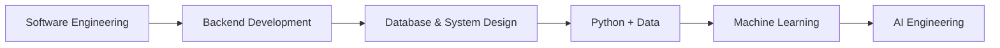

<div align="center">


<a href="https://github.com/TahaTirmizi">
  
</a>

<br/><br/>

[](https://linkedin.com/in/tahatirmizi)
[](https://youtube.com/@tahatirmizi)
[](mailto:tahatirmizi1@gmail.com)


</div>

---

## 👋 Hi, I'm Taha

I'm a **Software Engineering student** focused on building practical software, learning AI engineering, and developing a strong foundation in **backend systems, databases, and data-driven applications**.

I turn ideas into working projects and improve through **hands-on development, university coursework, experimentation, and problem solving**.

```text
Software Engineering → Backend → Databases → Python & Data → Machine Learning → AI Engineering
```

---

## 🔭 At a Glance

| | |
|---|---|
| 🎓 **Studying** | BS in Software Engineering |
| 🗄️ **Working with** | PostgreSQL, SQL, FastAPI, Python |
| 🧠 **Learning** | Machine Learning, AI Engineering, System Design |
| 🔧 **Tooling** | Git, GitHub, Linux/WSL, PowerShell, Bash |
| 🎥 **Creating** | Content on [YouTube](https://youtube.com/@tahatirmizi) |
| 📫 **Reach me** | [tahatirmizi1@gmail.com](mailto:tahatirmizi1@gmail.com) |

---

## 🚧 Currently Building

- 📈 **Stock Exchange Software**: full-stack app with FastAPI, PostgreSQL, and Next.js
- 🤖 **AI & automation experiments**: agents, productivity tools, and data analysis with Python
- 🧱 Strengthening my **SQL, backend, and system design** fundamentals

---

## 🛠️ Tech Stack

**Languages**


**Backend & Databases**


**AI & Data**


**Tools & Platforms**


---

## 💡 Featured Projects

<table>
<tr>
<td width="50%" valign="top">

### 🚑 E-Ambulance Dispatch System
A software engineering project to improve emergency ambulance dispatch and coordination.

- Emergency request management
- Ambulance and driver management
- Nearest-ambulance dispatch
- Hospital coordination
- Route and ETA tracking
- System design with DFDs and database modeling

</td>
<td width="50%" valign="top">

### 📊 Grade Analysis: Teacher Wise
A database-focused project on academic performance analysis.

- Relational database design
- SQL queries and joins
- Aggregate functions
- Teacher-wise grade analysis
- Percentage-based performance analysis

**Stack:** `PostgreSQL` `SQL`

</td>
</tr>
<tr>
<td width="50%" valign="top">

### 📈 Stock Exchange Software
A full-stack project exploring financial-market style applications.

- REST APIs with FastAPI
- PostgreSQL data layer
- Next.js frontend

**Stack:** `Python` `FastAPI` `PostgreSQL` `Next.js`

</td>
<td width="50%" valign="top">

### 🤖 AI & Automation Experiments
Hands-on experiments with AI-powered workflows.

- AI agents and assisted productivity tools
- Automated content workflows
- Machine learning experiments
- Data analysis with Python

**Stack:** `Python` `Pandas` `scikit-learn`

</td>
</tr>
</table>

> 🔗 Check out my [repositories](https://github.com/TahaTirmizi?tab=repositories) for code and updates.

---

## 🧭 Learning Roadmap



My goal is to understand not only **how to write code**, but how complete systems are **designed, built, deployed, and improved**.

---

## 🎯 2026 Goals

- [ ] Build stronger foundations in **AI Engineering**
- [ ] Become highly comfortable with **Python**
- [ ] Ship real-world **backend projects**
- [ ] Deepen **SQL and database engineering**
- [ ] Learn more **Machine Learning**
- [ ] Deploy meaningful projects
- [ ] Contribute to **open source**

---

## 📊 GitHub Stats

<div align="center">


</div>

---

<div align="center">

### 🛠️ Build. Break. Understand. Rebuild.
*Always learning. Always building.*


</div>
